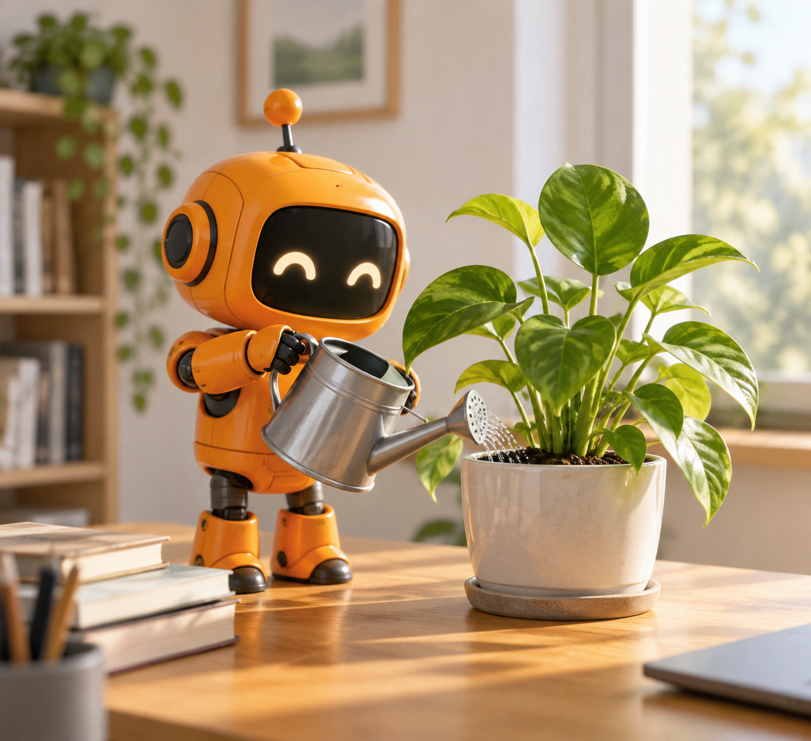
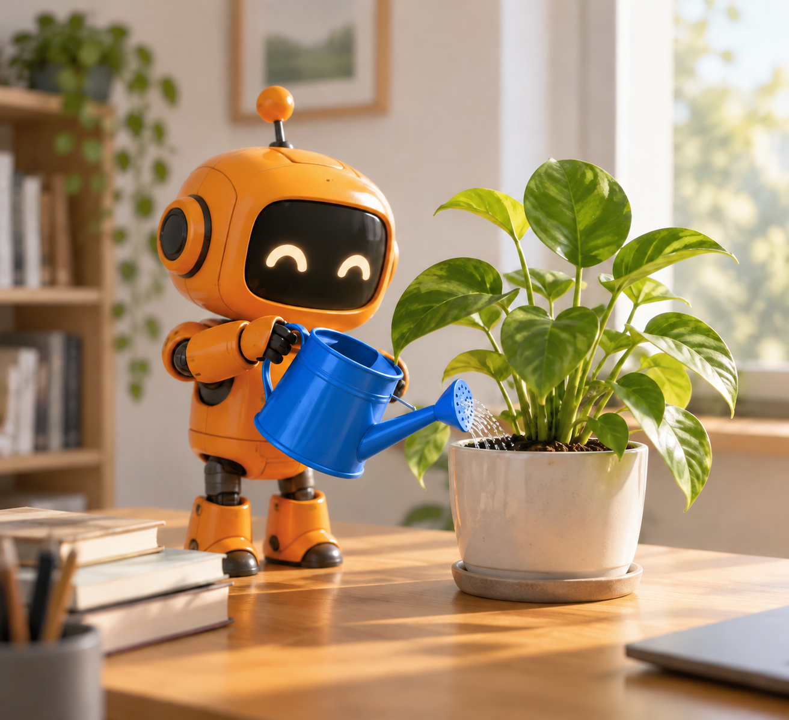
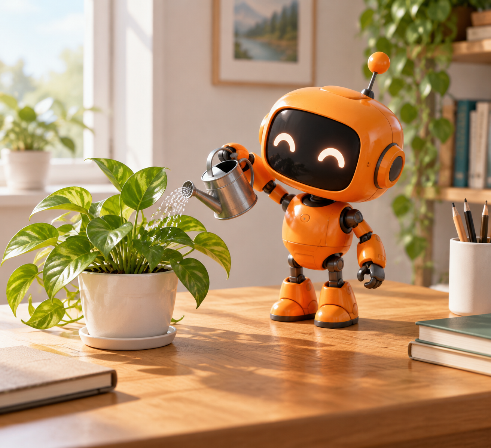
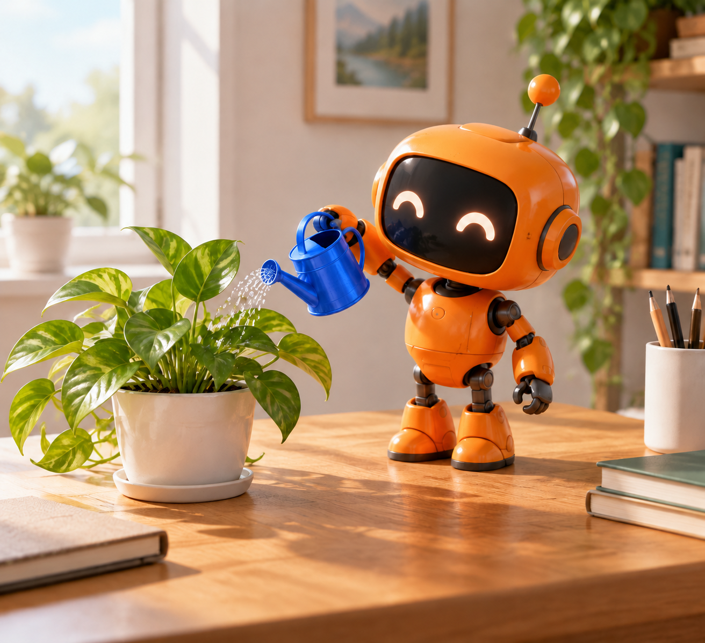
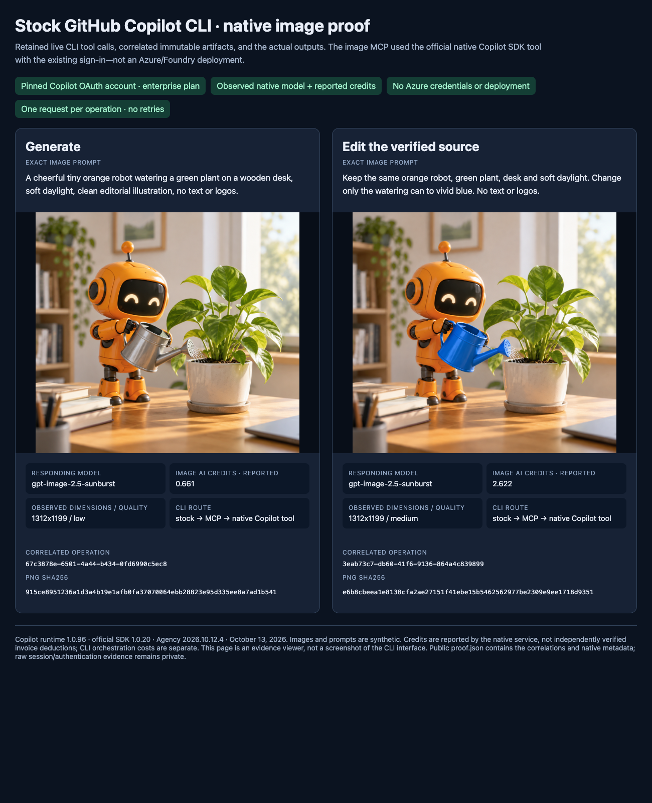
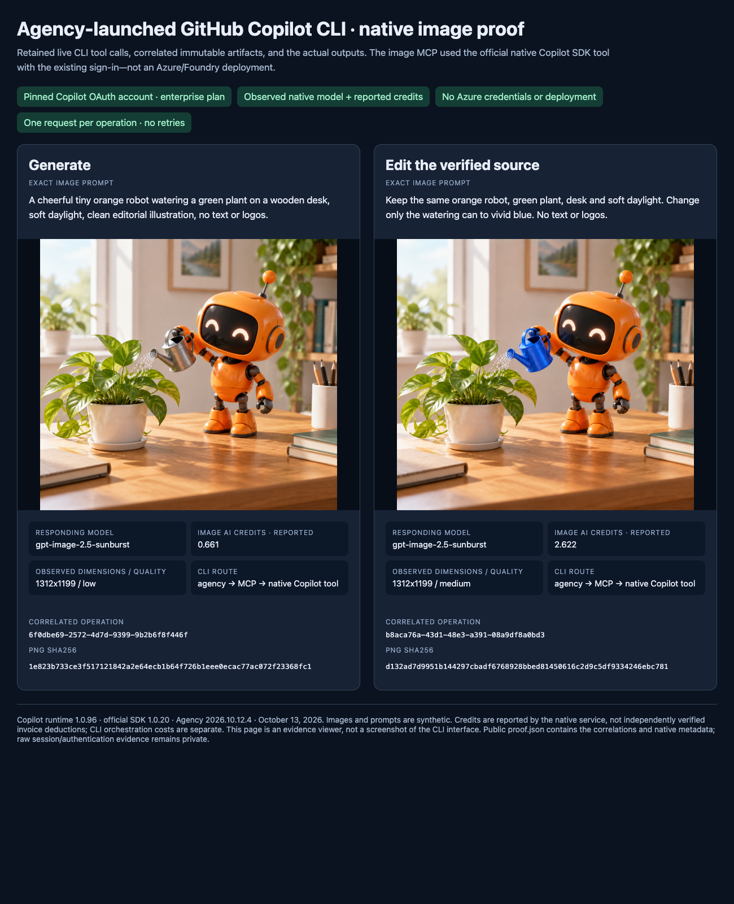

# Native Copilot backend qualification

This directory records bounded live qualification of the source-only experimental native GitHub Copilot backend on October 13, 2026. It does not claim that the already-published `@juanmicrosoft/image-gen-mcp@0.1.0` contains this backend.

## Result

All four correlated MCP cases succeeded: stock Copilot CLI generation and edit, plus Agency-launched Copilot CLI generation and edit. Each call produced one retained 1312×1199 PNG through the native SDK image tool. The service-selected model was `gpt-image-2.5-sunburst`; generation reported `low` quality and 0.661 image credits per case, while editing reported `medium` quality and 2.622 image credits per case. Total service-reported image usage was 6.566 credits. These values are not invoice deductions, and host chat/orchestration usage is separate.

Both edits changed the watering can from silver to vivid blue while retaining the orange robot, green plant, wooden desk and overall composition.

## Versions and revision boundary

| Item | Qualified value |
| --- | --- |
| Operating system | Local macOS |
| Copilot runtime | `1.0.96` |
| SDK | `@github/copilot-sdk@1.0.20` |
| Agency | `2026.10.12.4` |
| Authentication | Existing local OAuth `user`; session reported Enterprise plan |
| Stock generation source | `1027224ba3dc992dc261fa16738c86a809be37fb` |
| Stock edit source | `49e36bfbb70fd841fb44908c56436f17006bbd2f` |
| Agency generation source | `49e36bfbb70fd841fb44908c56436f17006bbd2f` |
| Agency edit source | `49e36bfbb70fd841fb44908c56436f17006bbd2f` |

The mixed revisions are intentional and must remain visible: stock generation ran before the final scoped selected-reference read fix, while the other three cases ran from `49e36bf`. The generation path was unchanged by that read-only edit repair.

The contribution later received the separate dependency upgrade proposed in juanmicrosoft/image-gen-mcp#101 (MCP SDK `1.31.0`, Sharp `0.35.5`). The combined source passed the production audit, all 80 offline tests, typecheck/build, the presentation test and clean package discovery. These retained paid image cases were not rerun after that dependency-only change and must not be described as live qualification of the upgraded dependencies.

## Isolation and launcher scope

The stock case launched the SDK runtime directly with a session-scoped MCP configuration. The Agency case used Agency `2026.10.12.4` with `--no-aec --no-default-mcps --no-config-plugins`; its Copilot child used `--no-custom-instructions --disable-builtin-mcps --available-tools mcp:*`, the session-scoped MCP configuration and exact MCP tool grants.

No Ouro configuration, persistent/global MCP registration, default MCP set, config plugin, account switch, token extraction or Azure provisioning participated. This evidence does not qualify persistent registration, other operating systems, WSL/containers/remote filesystems, other Copilot plans or authentication modes, or other host products.

## Synthetic prompts

Generation prompt:

> A cheerful tiny orange robot watering a green plant on a wooden desk, soft daylight, clean editorial illustration, no text or logos.

Edit prompt:

> Keep the same orange robot, green plant, desk and soft daylight. Change only the watering can to vivid blue. No text or logos.

## Correlated artifacts

| Launcher/action | Operation ID | Artifact ID | SHA-256 | Source lineage | Reported image credits |
| --- | --- | --- | --- | --- | ---: |
| Stock generate | `67c3878e-6501-4a44-b434-0fd6990c5ec8` | `173cbb5b-9925-4fc9-9658-c708cb992060` | `915ce8951236a1d3a4b19e1afb0fa37070064ebb28823e95d335ee8a7ad1b541` | New generation | 0.661 |
| Stock edit | `3eab73c7-db60-41f6-9136-864a4c839899` | `91b00d16-8ab3-4a9d-9362-0c43dc98177b` | `e6b8cbeea1e8138cfa2ae27151f41ebe15b5462562977be2309e9ee1718d9351` | Source artifact `173cbb5b-9925-4fc9-9658-c708cb992060`; source hash `915ce8951236a1d3a4b19e1afb0fa37070064ebb28823e95d335ee8a7ad1b541` | 2.622 |
| Agency generate | `6f0dbe69-2572-4d7d-9399-9b2b6f8f446f` | `7424ce9b-8ee6-4dd5-8edf-05a2d6a50ee1` | `1e823b733ce3f517121842a2e64ecb1b64f726b1eee0ecac77ac072f23368fc1` | New generation | 0.661 |
| Agency edit | `b8aca76a-43d1-48e3-a391-08a9df8a0bd3` | `f6d37ba6-bd5f-47e9-afe4-f52eef4ef3eb` | `d132ad7d9951b144297cbadf6768928bbed81450616c2d9c5df9334246ebc781` | Source artifact `7424ce9b-8ee6-4dd5-8edf-05a2d6a50ee1`; source hash `1e823b733ce3f517121842a2e64ecb1b64f726b1eee0ecac77ac072f23368fc1` | 2.622 |

Machine-readable values are in [`proof.json`](proof.json). The four PNG hashes in that file match the retained images in this directory.

## Images

### Stock

 

### Agency

 

## Evidence-viewer screenshots

The following screenshots are rendered viewers assembled from retained correlated evidence; they are not screenshots of a native Copilot CLI image interface.

## Boundaries

- The four image operations above are qualified only for the listed local macOS, runtime, SDK, Agency version, OAuth-user/Enterprise-plan and session-isolation configuration.
- The account login and raw CLI/MCP sessions remain private. This public record contains synthetic prompts, redacted identity summaries, artifact identifiers, hashes, versions, reported image usage and retained outputs.
- Cancellation after provider acceptance remains uncertain and may still incur usage.
- Reported AI credits are service metadata, not an invoice or monetary-cost calculation.
- Visual continuity is an observed result of these two edit cases, not a deterministic guarantee for future generations.
- Successful live cases do not replace final code review, upstream maintainer judgment, release/versioning decisions or qualification on other environments.
